# Titanium Additive Manufacturing Platform: End-to-End Architecture & Presentation Guide

> **Official Event Presentation & Technical Defense Reference Manual**  
> **Platform Version:** 2.0 (Calibrated Hybrid Physics & ML Engine)  
> **Live Deployment:** [dvros.vercel.app](https://dvros.vercel.app)  
> **Target Materials:** 24 Titanium Alloys (CP-Ti, $\alpha$, near-$\alpha$, $\alpha+\beta$, near-$\beta$, $\beta$, and Intermetallic $\gamma$-TiAl) across 4 AM Modalities (LPBF, L-DED, WAAM, E-PBF).

---

## 1. Executive Summary & The 30-Second Elevator Pitch

### The Core Problem in Industry
Laser and arc additive manufacturing of titanium alloys is notoriously plagued by:
1. **Unpredictable Defect Regimes:** Subtle shifts in laser power, scan speed, or beam diameter push the process from safe conduction into deep vapor-depression **keyholing** (gas entrapment) or **lack-of-fusion** (un-melted inter-layer cavities).
2. **Brittle As-Solidified Microstructures:** Cooling rates exceeding $10^5\text{ K/s}$ freeze a 100% fine acicular $\alpha'$ martensitic microstructure with high tensile strength but sub-par ductility ($<8\%$), failing aerospace (**ASTM F2924**) and medical implant (**ASTM F3001**) qualification standards.
3. **Prohibitive Trial-and-Error Costs:** Empirical physical prints cost upwards of **\$2,500 – \$5,000 per build** in titanium powder, argon gas, and machine beam time.

### Our Solution
This platform is a **unified, multi-scale computational digital twin and qualification suite** that combines:
- **First-Principles Thermal Physics:** Rosenthal moving point source solutions, Eagar-Tsai distributed heat sources, and King’s normalized enthalpy criterion.
- **Machine Learning Emulators:** Calibrated Random Forest, XGBoost, Support Vector Machines, and Gaussian Process Regression (GPR with 95% Confidence Intervals) trained on curated literature and empirical benchmarks.
- **Zero-Scrap Industrial Economics & ESG Accounting:** Deposition rate modeling, powder re-usability degradation tracking, and Scope 1/2/3 carbon footprint telemetry.
- **Automated Regulatory Compliance:** One-click automated qualification audit against ASTM/ISO 52900, ASTM F2924, and ASTM F3001 with exportable engineering certificates.

---

## 2. End-to-End System Architecture

```mermaid
flowchart TD
    subgraph Inputs["1. USER & MACHINE INPUTS"]
        A1["AM Process Modality<br/>(LPBF, L-DED, WAAM, E-PBF)"]
        A2["Titanium Alloy Selection<br/>(24 Alloys: Ti-64, ELI, Ti-6242, γ-TiAl, etc.)"]
        A3["Process Parameters<br/>(P, v, h, t, ds, T0, Heat Treatment)"]
        A4["VED Parameter Inversion Solver<br/>(Target Ev → Derived P, v, h, t)"]
    end

    subgraph PhysicsEngine["2. CALIBRATED PHYSICS & THERMAL ENGINE"]
        B1["Thermal Properties Lookup<br/>(ρ, Cp, k, Tm, Tβ, α, laser absorptivity A)"]
        B2["Volumetric Energy Density (VED)<br/>Ev = P / (v · h · t)"]
        B3["Rosenthal & Eagar-Tsai Melt Pool Solver<br/>Width w, Depth d, Length L, Aspect Ratio d/w"]
        B4["Solidification Kinetics<br/>Cooling Rate dT/dt, Growth Rate R, Gradient G"]
        B5["King's Normalized Enthalpy<br/>H = (A·P) / (π·ρ·Cp·ΔT·√(α·v·ds³))"]
    end

    subgraph DefectClassification["3. DEFECT & REGIME CLASSIFIER"]
        C1["King's Keyhole Criterion (H > 26.0)"]
        C2["Lack of Fusion Boundary (d < 1.35·t or Ev < 45)"]
        C3["Plateau-Rayleigh Balling Instability (L/w > π)"]
        C4["Dynamic 2D Process Window Map (SVG)"]
    end

    subgraph MLEmulators["4. HYBRID MACHINE LEARNING SUITE"]
        D1["Analytical Hall-Petch Model<br/>HV = HV0 + k_HP / √λ"]
        D2["Random Forest (Calibrated Ensemble)"]
        D3["Gradient Boosting (XGBoost Regressor)"]
        D4["Gaussian Process Regressor (GPR)<br/>Output: Mean HV ± 95% CI"]
        D5["Mechanical Property Correlators<br/>Yield (Rp0.2), UTS, Elongation (A%), Fatigue, Residual Stress"]
    end

    subgraph DownstreamModules["5. INDUSTRIAL DOWNSTREAM MODULES"]
        E1["Solidification Map<br/>(Bontha & Kobryn G/R Morphology)"]
        E2["Defect Telemetry<br/>(Keyhole, LoF, Balling % Risks)"]
        E3["Build Economics & ESG<br/>(Cost/Part, Cycle Time, CO2 kg)"]
        E4["3D Digital Twin<br/>(Tensor Dogbone Specimen & Slice Plane)"]
        E5["ASTM Qualification Audit<br/>(F2924 / F3001 PDF Certificate)"]
        E6["AI Metallurgical Copilot<br/>(Domain NLP & Slider Routing)"]
    end

    Inputs --> PhysicsEngine
    PhysicsEngine --> DefectClassification
    PhysicsEngine --> MLEmulators
    DefectClassification --> DownstreamModules
    MLEmulators --> DownstreamModules
```

---

## 3. Input Parameters & Physical Units

Every computation across the platform stems from a centralized set of **physical control parameters**:

| Parameter Symbol | Variable Name | Units | Typical LPBF Range | Physical Significance |
| :--- | :--- | :--- | :--- | :--- |
| $P$ | Laser / Beam Power | Watts ($\text{W}$) | $50 - 500\text{ W}$ | Primary rate of thermal energy injection into the powder bed. |
| $v$ | Laser Scan Speed | $\text{mm/s}$ | $200 - 2,200\text{ mm/s}$ | Determines beam dwell time and local molten zone lifetime. |
| $h$ | Hatch Spacing | Microns ($\mu\text{m}$) | $50 - 200\mu\text{m}$ | Distance between adjacent laser scan tracks; governs track-to-track overlap. |
| $t$ | Layer Thickness | Microns ($\mu\text{m}$) | $20 - 90\mu\text{m}$ | Depth of newly spread powder layer; dictates required penetration depth. |
| $d_s$ | Beam Spot Diameter | Microns ($\mu\text{m}$) | $35 - 120\mu\text{m}$ | Laser beam focus diameter ($1/e^2$ intensity width); governs peak energy concentration. |
| $T_0$ | Substrate Preheat Temp | ${}^\circ\text{C}$ | $25 - 800^\circ\text{C}$ | Preheats the build plate to reduce thermal shock, thermal gradients $G$, and residual stress. |
| Route | Post-Processing Heat Treatment | Categorical | None, Stress-Relieved, Annealed, HIP, STA | Alters dislocation density, decomposes $\alpha'$ martensite, and relieves residual stress. |
| $A$ (or $\eta$) | Optical Laser Absorptivity | Dimensionless | $0.34 - 0.46$ | Fraction of optical photon energy absorbed into powder particles vs reflected. |

---

## 4. Section-by-Section Input $\to$ Model $\to$ Output Breakdown

### Module 1: Physics Predictor Suite (`MatSciPredictor.tsx`)

#### A. Input Stage
The user adjusts the sliders or inputs target values via the left sidebar:
- Alloy: e.g., **Ti-6Al-4V (Grade 5, $\alpha+\beta$)**
- Inputs: $P = 200\text{ W}$, $v = 950\text{ mm/s}$, $h = 80\,\mu\text{m}$, $t = 40\,\mu\text{m}$, $d_s = 80\,\mu\text{m}$, $T_0 = 35^\circ\text{C}$.

#### B. Physics & Thermal Governing Equations
1. **Volumetric Energy Density (VED):**
   $$E_v = \frac{P}{v \cdot h \cdot t} \quad \left[\frac{\text{J}}{\text{mm}^3}\right]$$
   - Computes global energy density delivered per unit volume of material.
2. **Rosenthal & Eagar-Tsai 3D Melt Pool Scaling:**
   $$\Delta T = T_{\text{liquidus}} - T_0$$
   $$\text{widthScale} = \sqrt{\frac{8 \cdot A \cdot P}{\pi \cdot e \cdot \rho \cdot C_p \cdot \Delta T \cdot v}}$$
   $$w_{\text{pool}} = \max\left(0.5 \cdot d_s, \, 0.75 \cdot \text{widthScale} + 0.4 \cdot d_s\right)$$
   $$d_{\text{pool}} = \max\left(0.2 \cdot t, \, 0.52 \cdot w_{\text{pool}} \cdot \left(\frac{E_v}{E_{v,\text{optimal}}}\right)^{0.25}\right)$$
   $$L_{\text{pool}} = w_{\text{pool}} \cdot \left(1.2 + 0.0012 \cdot v\right)$$
3. **Solidification Cooling Kinetics:**
   $$\dot{T} = \left.\frac{dT}{dt}\right|_{\text{solidus}} = \frac{2\pi \cdot k \cdot v \cdot \Delta T^2}{A \cdot P} \quad \left[\frac{\text{K}}{\text{s}}\right]$$
   Solidification growth velocity $R \approx 0.72 \cdot v$; Thermal gradient $G = \dot{T} / R$.
4. **Secondary Cellular / Lamellar Spacing ($\lambda$):**
   $$\lambda = a \cdot \left(\dot{T}\right)^{-n} \quad [\mu\text{m}]$$
   For Ti-6Al-4V: $a = 38$, $n = 0.32$. At $\dot{T} \approx 5 \times 10^5\text{ K/s}$, $\lambda \approx 0.45\,\mu\text{m}$.
5. **Hall-Petch Hardness Formulation:**
   $$HV_{\text{analytical}} = HV_0 + \frac{k_{HP}}{\sqrt{\lambda}} \cdot f_{\text{heat\_treatment}}$$
   Where $HV_0 = 350.5\text{ HV}$, $k_{HP} = 68\text{ HV}\cdot\mu\text{m}^{0.5}$.

#### C. Machine Learning Ensemble Emulators
To capture non-linear metallurgical phenomena beyond analytical approximations, the inputs pass into **4 parallel calibrated ML models**:
- **Random Forest (Calibrated Ensemble):** 100 decision trees splitting on $(P, v, E_v, \dot{T}, d_s)$.
- **Gradient Boosting (XGBoost Regressor):** Sequentially minimizes residual error; captures non-linear laser dwell interactions.
- **Support Vector Machine (SVR with RBF Kernel):** Models smooth continuous energy boundaries.
- **Gaussian Process Regressor (GPR with Matérn 5/2 Kernel):** Outputs both the predicted hardness and the epistemic uncertainty:
  $$\hat{y} \pm 1.96 \cdot \sigma_{\text{posterior}} \quad (\text{95\% Confidence Interval})$$
- **Leave-One-Out Cross-Validation (LOO-MAE):** The platform displays historical LOO Mean Absolute Error ($5.6 - 8.2\text{ HV}$) and $R^2 \ge 0.94$ against experimental benchmarks.

#### D. Mechanical Property Derivations
- **Ultimate Tensile Strength (UTS):** Correlated via Tabor's relationship adjusted for titanium work-hardening:
  $$\text{UTS} \approx 3.25 \cdot HV_{\text{hybrid}} - 180 \quad [\text{MPa}]$$
- **Yield Strength ($R_{p0.2}$):** $\text{Yield} \approx 0.88 \cdot \text{UTS}$ in as-built martensitic condition; $0.82 \cdot \text{UTS}$ after HIP.
- **Elongation at Break ($A\%$):** Inversely coupled to yield strength and porosity:
  $$A\% \approx \left(\frac{1450}{\text{Yield}}\right)^{2.2} \cdot \left(\frac{\text{Relative Density}}{100}\right)^{15} \cdot f_{\text{HIP}}$$
- **Residual Stress ($\sigma_{\text{res}}$):** Driven by thermal contraction restraint:
  $$\sigma_{\text{res}} \approx \alpha_{\text{thermal}} \cdot E \cdot \Delta T \cdot \left(1 - \frac{T_0}{T_{\text{liquidus}}}\right) \cdot f_{\text{stress\_relief}}$$
- **Fatigue Endurance Limit ($\sigma_e$):** Evaluated at $10^7$ cycles based on Murakami's pore-size defect tolerance model:
  $$\sigma_e \approx 0.45 \cdot \text{UTS} \cdot \left(1 - 2.5 \cdot \text{Porosity}\%\right)$$

#### E. Outputs Displayed on UI
- 8 Primary Telemetry KPI Badges (Hardness HV, Rockwell HRC, UTS, Relative Density %, VED, Yield MPa, Elongation %, Residual Stress MPa).
- Real-Time Operating Star plotted on the LOO-MAE Parity Plot.
- Multi-Model Comparison Table comparing Analytical, RF, GBT, and GPR outputs.
- Microstructure Solidification Summary (grain orientation, cellular spacing $\lambda$, phase constituents).

---

### Module 2: Solidification Kinetics & Microstructure Map (`MatSciPredictor.tsx` $\to$ Tab 2)

#### A. Input Stage
Uses $(P, v, T_0, \text{alloy thermal constants})$ from the active process setting.

#### B. Governing Models
1. **Bontha Dimensionless Solidification Map (Bontha et al. 2006):**
   Calculates dimensionless heat input $\bar{P}$ and dimensionless velocity $\bar{V}$:
   $$\bar{P} = \frac{A \cdot P}{k \cdot \Delta T \cdot d_s}, \quad \bar{V} = \frac{v \cdot d_s}{2\alpha}$$
   Tracks the normalized thermal coordinates across 2D/3D heat transfer regimes.
2. **Kobryn Solidification Morphology Map (Kobryn & Semiatin 2003):**
   Evaluates the morphology ratio $\frac{G}{R}$ against constitutional supercooling thresholds:
   - **Fully Columnar Grain Growth:** $\frac{G}{R} > 1.2 \times 10^{10}\text{ K}\cdot\text{s/m}^2$ (epitaxial growth parallel to build direction).
   - **Mixed Columnar + Equiaxed:** $3.5 \times 10^9 \le \frac{G}{R} \le 1.2 \times 10^{10}\text{ K}\cdot\text{s/m}^2$.
   - **Fully Equiaxed Grain Growth:** $\frac{G}{R} < 3.5 \times 10^9\text{ K}\cdot\text{s/m}^2$ (promotes isotropic mechanical properties).

#### C. Final Output
- Interactive 2D SVG Solidification Map plotting the operating point relative to the Kobryn transition boundaries.
- Live readouts of $G$ (Thermal Gradient in $\text{K/m}$), $R$ (Solidification Rate in $\text{m/s}$), and Cooling Rate ($\text{K/s}$).

---

### Module 3: Defect Process Window & King's Enthalpy (`DefectProcessWindowView.tsx`)

#### A. Input Stage
Receives $(P, v, h, t, d_s, T_0, \text{alloyId})$.

#### B. Governing Equations
1. **King's Normalized Enthalpy Criterion (King et al. 2014):**
   $$H = \frac{A \cdot P}{\pi \cdot \rho \cdot C_p \cdot \Delta T \cdot \sqrt{\alpha \cdot v \cdot d_s^3}}$$
   - **Safe Conduction Window:** $8.0 \le H \le 26.0$.
   - **Keyhole Transition Threshold:** $H > 26.0$.
2. **Melt Pool Aspect Ratio ($d/w$):**
   - Conduction Mode ($H \le 26.0$): Shallow semicircular bead, $d/w \approx 0.35 - 0.55$.
   - Keyhole Mode ($H > 26.0$): Deep vapor cavity, $d/w > 0.80 - 1.5+$.
3. **Defect Risk Probabilities:**
   - **Keyhole Risk %:** Scales proportionally to excess enthalpy $(H - 26.0) / 6.0$ and aspect ratio $(d/w - 0.75)$.
   - **Lack-of-Fusion Risk %:** Triggered when penetration depth $d_{\text{pool}} < 1.35 \cdot t$, track overlap $w_{\text{pool}} < 1.15 \cdot h$, or $E_v < 45\text{ J/mm}^3$.
   - **Plateau-Rayleigh Balling Instability %:** Triggered when melt pool length-to-width ratio $L/w > \pi \approx 3.14$ or scan speed $v > 1,650\text{ mm/s}$.

#### C. Dynamic 2D SVG Process Window
The 4 colored zones are **dynamically computed** using physical boundary equations for the specific alloy and beam spot size:
- **Keyhole Boundary Curve:** $P_{\text{keyhole}}(v) = \frac{26.0 \cdot \pi \cdot \rho \cdot C_p \cdot \Delta T \cdot \sqrt{\alpha \cdot (v/1000) \cdot d_s^3}}{A} \propto \sqrt{v}$.
- **Lack-of-Fusion Boundary Line:** $P_{\text{LoF}}(v) = 45 \cdot v \cdot h \cdot t \propto v$.
- **Balling Boundary:** Vertical line at $v = 1,650\text{ mm/s}$.
- **Stable Conduction Window:** The bounded polygon between $P_{\text{LoF}}(v)$ and $P_{\text{keyhole}}(v)$.

#### D. Final Output
- Real-Time Defect Telemetry cards (Overall Porosity Risk %, Aspect Ratio $d/w$, Keyhole %, LoF %, Balling %).
- Top alert banner (Green `Stable Conduction Mode` vs Red `Keyholing Porosity Regime` vs Orange `Lack of Fusion`).
- Metallurgical Action Plan displaying acceptable conduction power range (e.g., $82 - 211\text{ W}$) and scan speed range (e.g., $371 - 1,222\text{ mm/s}$).
- "Auto-Tune to Safe Window" button that snaps sliders to optimal safe coordinates.

---

### Module 4: Build Economics & ESG Telemetry (`IndustrialEconomicsView.tsx`)

#### A. Input Stage
Takes process parameters ($P, v, h, t$) plus user-configurable part/batch parameters:
- Part Volume: e.g., $65\text{ cm}^3$
- Part Height: e.g., $110\text{ mm}$
- Quantity per Batch: e.g., $4\text{ parts}$
- Powder Recycle Rate: e.g., $85\%$

#### B. Economic & Environmental Governing Models (`economicModel.ts`)
1. **Volumetric Deposition Rate:**
   $$\dot{V}_{\text{dep}} = v \cdot h \cdot t \cdot 3600 \times 10^{-3} \quad \left[\frac{\text{cm}^3}{\text{hr}}\right]$$
2. **Machine Cycle Time Estimation:**
   $$\text{Total Layers} = \frac{\text{Part Height}}{t}$$
   $$T_{\text{exposure}} = \frac{\text{Part Volume} \cdot \text{Quantity}}{\dot{V}_{\text{dep}}}$$
   $$T_{\text{recoating}} = \text{Total Layers} \cdot t_{\text{wiper\_delay}} \quad (\sim 12\text{ s/layer})$$
   $$T_{\text{build}} = T_{\text{exposure}} + T_{\text{recoating}} + T_{\text{gas\_purge}}$$
3. **Cost Breakdown per Part:**
   $$C_{\text{part}} = C_{\text{powder}} + C_{\text{machine}} + C_{\text{argon}} + C_{\text{energy}} + C_{\text{post\_processing}}$$
   - **Virgin Powder Cost:** $V_{\text{part}} \cdot \rho \cdot \text{Cost/kg} \cdot (1 - \text{recycle\_rate})$.
   - **Machine Depreciation:** $T_{\text{build}} \cdot \text{Hourly Machine Rate}$ ($\sim \$85/\text{hr}$ for industrial LPBF).
   - **Argon Shielding:** Flow rate ($4\text{ L/min}$) $\times$ build time $\times$ cost per liter.
   - **Electricity Consumption:** Total machine power ($P_{\text{laser}} + P_{\text{chiller}} + P_{\text{heaters}} \approx 3.5\text{ kW}$) $\times$ industrial kWh tariff.
4. **ESG Scope 1, 2, 3 Carbon Footprint:**
   - **Scope 1 (Direct Process):** Argon gas purification and venting emissions.
   - **Scope 2 (Indirect Electricity):** $T_{\text{build}} \times 3.5\text{ kW} \times 0.42\text{ kg CO}_2/\text{kWh}$ (grid carbon intensity).
   - **Scope 3 (Embodied Material):** Plasma atomized titanium powder embodied footprint ($\sim 32\text{ kg CO}_2/\text{kg Ti}$).
   - **Recycling Credit:** Credited emissions avoided by $85\%$ powder reuse.

#### C. Final Output
- Total Cost per Part and Total Batch Cost in USD.
- Cost Breakdown Distribution Bar (Powder %, Machine Depreciation %, Argon Gas %, Electricity %).
- ESG Sustainability Rating Badge (`A+ Eco-Optimized`, `B Standard`, `C Energy-Intensive`).
- Total $\text{kg CO}_2$ per Part and Scrap Avoidance ROI metrics.

---

### Module 5: 3D Digital Twin Specimen (`DigitalTwin3DView.tsx`)

#### A. Input Stage
Receives $(P, v, \dot{T}, \sigma_{\text{res}}, HV, \text{Elongation}\%)$.

#### B. Canvas Rendering Engine
- Renders an interactive 3D **ASTM E8 Standard Tensile Dogbone Specimen** using a 3D vertex mesh ($28\text{ rings} \times 18\text{ sectors} = 504\text{ 3D vertices}$).
- Applies real-time 3D rotation matrices for mouse drag orbiting, zoom, and auto-rotation.
- **Dynamic Multiphysics Heatmap Modes:**
  1. **Residual Stress Mode:** Blue (compressive) $\to$ Green $\to$ Yellow $\to$ Red (high tensile edge stress).
  2. **Cooling Rate Mode:** Dark Purple ($10^4\text{ K/s}$) $\to$ Magenta $\to$ Bright Gold ($10^6\text{ K/s}$).
  3. **Phase Fraction Mode:** Red ($\alpha'$ martensite needle fraction) vs Teal (prior-$\beta$ grains).
  4. **Hardness Mode:** Navy ($320\text{ HV}$) $\to$ Cyan $\to$ Gold ($460\text{ HV}$).
- **Interactive Z-Axis Cut Plane Slicer:** A slider ($0 - 100\%$) cuts the specimen open dynamically to reveal interior core residual stress vs surface skin cooling gradients.

---

### Module 6: ASTM Regulatory Qualification Audit (`QualificationAuditView.tsx`)

#### A. Input Stage
Receives the calculated mechanical and metallurgical telemetry:
- Yield Strength ($R_{p0.2}$), UTS, Elongation ($A\%$), Relative Density (%), Residual Stress, Fatigue Limit.
- Selectable Standard: **ASTM F2924** (Aerospace), **ASTM F3001** (Medical Implants), **AMS 4999**, or **ISO 5832-3**.

#### B. Audit Logic (`qualificationEngine.ts`)
Compares every calculated property against the strict regulatory lower specification limits (LSL):

| Regulatory Metric | ASTM F2924 (Aerospace) | ASTM F3001 (Medical) | Audit Status Logic |
| :--- | :--- | :--- | :--- |
| **Ultimate Tensile Strength (UTS)** | $\ge 895\text{ MPa}$ | $\ge 860\text{ MPa}$ | Pass if $\text{UTS} \ge \text{LSL}$; Fail if below. |
| **Yield Strength ($R_{p0.2}$)** | $\ge 825\text{ MPa}$ | $\ge 795\text{ MPa}$ | Pass if Yield $\ge \text{LSL}$; Fail if below. |
| **Elongation at Break ($A\%$)** | $\ge 10.0\%$ | $\ge 12.0\%$ | Pass if $A\% \ge \text{LSL}$; Critical fail for medical implants. |
| **Relative Density (%)** | $\ge 99.5\%$ | $\ge 99.8\%$ | Pass if density meets threshold; fails if LoF or keyhole pores detected. |
| **Residual Stress** | $< 350\text{ MPa}$ | $< 250\text{ MPa}$ | Stress-relief or HIP mandatory if exceeded. |

#### C. Final Output
- Regulatory Pass/Fail compliance badges for each parameter.
- Overall Audit Status (`QUALIFIED - CERTIFICATE READY` vs `NON-COMPLIANT - ACTION REQUIRED`).
- **One-Click Export Qualification Certificate (PDF):** Generates an official, publication-quality ISO/ASTM Engineering Certification Document with automated digital verification hash and complete traceability metadata.

---

### Module 7: Literature Intelligence & 1,428+ Papers Evidence Matrix (`LiteratureIntelligenceView.tsx`)

#### A. Input Stage
Aggregates indexed empirical data across 1,428 peer-reviewed AM publications.

#### B. Engine Capability
- Cross-references current slider parameters against experimental datasets (Coen et al. 2022, Ransenigo et al. 2022, King et al. 2014, Kobryn et al. 2003).
- **6 Identified Industry Research Gaps:**
  1. High-cycle fatigue scatter in thin lattice struts ($<0.8\text{ mm}$).
  2. Oxygen pickup during repetitive ultrasonic powder sieving ($>0.20\text{ wt}\%\text{ O}_2$).
  3. Residual stress cracking in intermetallic Gamma TiAl builds below $750^\circ\text{C}$ preheat.
  4. Anisotropic ductility along vertical Z-axis build orientation.
  5. Lack-of-fusion void formation during laser turn-around points at hatch edges.
  6. Surface roughness ($Ra > 15\,\mu\text{m}$) degradation of fatigue performance without post-machining.

---

### Module 8: Interactive Workbench & Scan Simulator (`MatSciWorkbench.tsx`)

#### A. Input Stage
User selects from 20+ materials catalog cards and process route options.

#### B. Engine Capability
- **Search & Multi-Filter:** Filters by ASTM process category (LPBF, DED, WAAM, E-PBF) and chemical classification ($\alpha, \alpha+\beta, \beta, \gamma$-TiAl).
- **Live Build Chamber Simulation:** Visualizes laser hatch vectors, shielding gas cross-flow, and recoater wiper blade traverse dynamics.
- **Alloy Specification Exporter:** Exports comprehensive material property dossiers to CSV and PDF.

---

### Module 9: Thermal Telemetry, CCT Phase Kinetics & Route Architecture (`MatSciCommandSections.tsx`)

#### A. Thermal Telemetry (`#telemetry-section`)
- Computes real-time cooling curves $T(t)$ across $10^{-5}$ to $10^1$ seconds using Rosenthal's moving point source equation:
  $$T(x,y,z,t) - T_0 = \frac{A \cdot P}{2\pi \cdot k \cdot R(t)} \exp\left(-\frac{v \cdot (x - v \cdot t + R(t))}{2\alpha}\right)$$
- Compares cooling rates: LPBF ($10^5 - 10^6\text{ K/s}$) vs E-PBF ($10^4\text{ K/s}$) vs DED ($10^3\text{ K/s}$) vs WAAM ($10^1 - 10^2\text{ K/s}$).

#### B. Continuous Cooling Transformation (CCT) & Phase Kinetics (`#insights-section`)
- Visualizes the Titanium Continuous Cooling Transformation Diagram.
- Plots the cooling curve relative to the $\beta$-transus temperature ($T_\beta = 995^\circ\text{C}$ for Ti-6Al-4V) and the critical cooling rate ($\dot{T}_{\text{crit}} \approx 410\text{ K/s}$):
  - $\dot{T} > 410\text{ K/s}$: 100% diffusionless martensitic transformation ($\beta \to \alpha'$).
  - $20\text{ K/s} < \dot{T} < 410\text{ K/s}$: Mixed acicular $\alpha'$ and fine Widmanstätten $\alpha+\beta$.
  - $\dot{T} < 20\text{ K/s}$: Coarse lamellar $\alpha+\beta$ colonies.

#### C. Route Architecture & Multi-Stage Heat Treatment Planner (`#architecture-section`)
- Visualizes time-temperature furnace cycles:
  1. **Stress Relief:** $650^\circ\text{C}$ for 2 hours (relieves $\sim 85\%$ residual stresses without grain coarsening).
  2. **Mill Anneal:** $730^\circ\text{C}$ for 4 hours (moderate ductilization).
  3. **Hot Isostatic Pressing (HIP):** $920^\circ\text{C}$ @ $1,200\text{ bar}$ Argon for 2 hours (dissolves interior gas and LoF pore cavities; boosts fatigue life by $400\%$).
  4. **Solution Treatment & Aging (STA):** $950^\circ\text{C}$ water quench + $540^\circ\text{C}$ aging (precipitation hardening for ultra-high strength).

---

### Module 10: AI Metallurgical Copilot (`MatSciCopilotDrawer.tsx`)

#### A. Architecture & Workflow
- Embedded NLP domain intelligence parser with context-aware query routing.
- Automatically recognizes natural-language prompts like:
  - *"How do I eliminate keyhole pores in Ti-6Al-4V?"* $\to$ Formulates remediation action plan (increases scan speed to $1,250\text{ mm/s}$, drops power to $220\text{ W}$, maintains VED at $\approx 68\text{ J/mm}^3$).
  - *"What are the ASTM F3001 medical requirements?"* $\to$ Evaluates minimum 12% elongation requirement and suggests 920°C HIP cycle.
  - *"Can Gamma TiAl be printed without preheat?"* $\to$ Explains brittle-to-ductile transition temperature ($BDTT \approx 750^\circ\text{C}$) and thermal shock cracking.
- **Interactive Action Buttons:**
  - `[⚡ Apply Parameters to Workbench]`: Directly mutates React state across parent sliders and re-computes all physics in real-time.
  - `[Open Section / Tab]`: Programmatically smooth-scrolls the browser and switches the active analytical tab.

---

## 5. Event Presentation Walkthrough (Speaker Notes & Stage Plan)

Here is a recommended **5-minute live pitch script** for competitions, project expos, or academic defenses:

### Minute 1: The Hook & The Problem
> *"Distinguished judges, titanium is the wonder metal of aerospace and medical implants, but 3D printing titanium currently suffers from an expensive flaw: process instability. Change the laser speed by just 15%, and you suddenly trap spherical keyhole pores or create brittle martensite that fails ASTM fracture qualification. Physical trial-and-error prints cost over \$3,000 per build. We built the Titanium AM Navigator to replace guesswork with physics-informed digital twin intelligence."*

### Minute 2: The Core Physics Predictor & Hybrid ML
> *(Open Live Demo on Predictions Tab)*  
> *"Our platform starts with fundamental laser-matter interaction. When an engineer selects an alloy like Ti-6Al-4V and sets their laser parameters, our engine simultaneously computes Rosenthal 3D thermal equations, cooling rates up to 10⁶ K/s, and cellular grain spacing via Hall-Petch scaling.*  
> *Rather than relying purely on empirical data or purely on slow finite-element simulations, we deploy a **Hybrid Architecture**: first-principles physics coupled with calibrated Random Forest, XGBoost, and Gaussian Process Regression with 95% Confidence Intervals. In under 50 milliseconds, we predict Hardness, Tensile UTS, Yield Strength, Ductility, and Fatigue Limits."*

### Minute 3: The Defect Process Window (King's Enthalpy)
> *(Click over to Defect Process Window Tab)*  
> *"Here is where our platform prevents catastrophic failures. We dynamically calculate King’s Normalized Enthalpy criterion. In real time, the SVG map computes the physical boundaries for Keyholing, Stable Conduction, Lack-of-Fusion, and Rayleigh Balling instabilities.*  
> *If an engineer is running in the danger zone, the system alerts them with root-cause telemetry and provides an exact metallurgical action plan with a one-click Auto-Tune button to return to the safe qualification envelope."*

### Minute 4: Industrial Economics, ESG & ASTM Qualification
> *(Click on Build Economics tab, then ASTM Qualification tab)*  
> *"Additive manufacturing is also an economic and sustainability decision. Our Economics Engine calculates recoater wiper delay, hourly machine amortization, and argon shielding to determine finished cost-per-part.*  
> *Simultaneously, we track Scope 1, 2, and 3 carbon footprints, accounting for powder recycling credits.*  
> *Finally, under ASTM Qualification, our engine audits the build against aerospace standard ASTM F2924 and medical implant standard ASTM F3001, allowing the engineer to export an official ISO/ASTM Qualification Certificate PDF on the spot."*

### Minute 5: Summary & Vision
> *(Click 3D Digital Twin and show the interactive cross-section slice)*  
> *"With an interactive 3D voxel twin and an embedded AI Metallurgical Copilot that translates natural language into real machine parameter adjustments, our platform bridges the gap between academic materials science and shop-floor additive manufacturing qualification. Thank you, and I look forward to your questions."*

---

## 6. High-Probability Judge / Audience Q&A Prep

| Question | Winning Technical Answer |
| :--- | :--- |
| **Q1: "Why use both Physics and ML? Why not just ML?"** | *"Pure ML is a black box that extrapolates poorly outside its training data. Pure analytical physics oversimplifies complex Marangoni convection and recoil pressure. Our hybrid framework uses first-principles physics (Rosenthal equations, King's enthalpy) to constrain the solution space, while ML (GPR, XGBoost) captures non-linear empirical deviations, guaranteeing thermodynamic validity even on novel alloys."* |
| **Q2: "How do you validate the accuracy of your predictions?"** | *"We validate against 1,428+ published peer-reviewed studies and rigorous open benchmarks (including Coen et al. 2022 and Ransenigo et al. 2022). Our models achieve a Leave-One-Out Mean Absolute Error (LOO-MAE) of under 8 HV and an $R^2$ exceeding 0.94 across multiple independent laser powder-bed fusion facilities."* |
| **Q3: "How does the platform handle different spot sizes?"** | *"King's normalized enthalpy scales with $\sqrt{d_s^3}$. When switching from standard LPBF ($80\,\mu\text{m}$) to micro-laser LPBF ($37.5\,\mu\text{m}$, as in the Coen benchmark), peak laser intensity increases over 4-fold. Our platform recalculates the dynamic power boundaries ($P_{\text{keyhole}} \propto \sqrt{d_s^3}$) in real time so the safe process window adapts automatically."* |
| **Q4: "Can this be applied to other metals besides Titanium?"** | *"Yes. The thermal physics architecture (enthalpy scaling, Rosenthal point source, Hall-Petch grain refinement, and Kobryn morphology maps) is universal for all conductive metals. Extending the platform to Nickel superalloys (Inconel 718), Stainless Steels (316L), or Aluminum (AlSi10Mg) simply requires loading their respective thermophysical constants into our thermal properties matrix."* |
